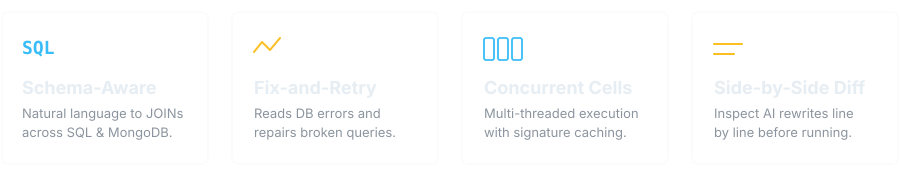
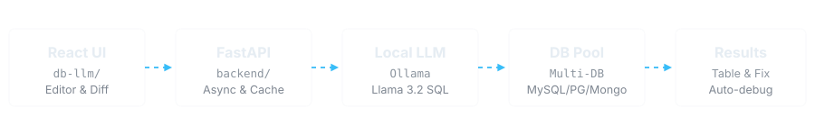

<div align="center">
  
</div>

<br/>

## Overview

**Query Pilot** is a full-stack database workspace and AI SQL assistant powered by a FastAPI backend, a React + Vite editor (`db-llm/`), and local LLM inference via Ollama (Llama 3.2). Write natural language, inspect schema-aware SQL diffs side-by-side, execute queries concurrently across SQL and NoSQL engines, and let the fix-and-retry debugger resolve errors automatically.

<div align="center">
  
</div>

## Architecture

<div align="center">
  
</div>

- **Multi-Threaded & Async Execution:** FastAPI `asyncio` endpoints offload heavy queries to background worker threads so the workspace stays responsive across concurrent notebook cells.
- **Signature-Based Caching:** Caches frequent query results with adaptive TTL policies and optimized connection pooling.
- **Fix-and-Retry Debugging:** Captures database execution errors and unknown-column failures, then proposes corrected SQL in a side-by-side diff view.

## Quick start

```bash
# 1. Install Python venv + backend requirements and frontend node_modules
./setup.sh

# 2. Start Ollama (Llama 3.2), FastAPI backend, and React frontend
./start.sh
```

## Supported databases

| SQL Databases | Status | NoSQL Databases | Status |
| :--- | :--- | :--- | :--- |
| MySQL | Ready | MongoDB | Ready |
| PostgreSQL | Ready | Neo4j | Coming soon |
| SQLite | Ready | Redis | Coming soon |
| Databricks | Coming soon | Amazon DynamoDB | Coming soon |
| Snowflake | Coming soon | Apache Cassandra | Coming soon |
| BigQuery | Coming soon | -- | -- |

## Backend API

<details>
<summary><b>API endpoints &amp; project structure</b></summary>

<br/>

### Test Database Connection

```http
POST /api/test-connection/{engine}
Content-Type: application/json

{
  "host": "localhost",
  "port": 5432,
  "database": "mydb",
  "username": "user",
  "password": "pass"
}
```

### Generate SQL from Natural Language

```http
POST /api/ai/generate-sql
Content-Type: application/json

{
  "natural_language": "Find all customers from New York",
  "schema": "customers(id, name, city, country)"
}
```

### Project layout

```text
Query-Pilot/
  backend/
    main.py              FastAPI application with async/concurrent handling
    requirements.txt     Python dependencies
  db-llm/
    src/                 React + Vite frontend (Workspace, QueryPilot, CodeDiffView, themes)
    package.json         Frontend dependencies
  setup.sh               Full backend + frontend environment setup
  start.sh               Starts Ollama, FastAPI backend, and Vite dev server
```

</details>

## License

MIT License — see `LICENSE` for details.

<br/>

<div align="center">
  
</div>
